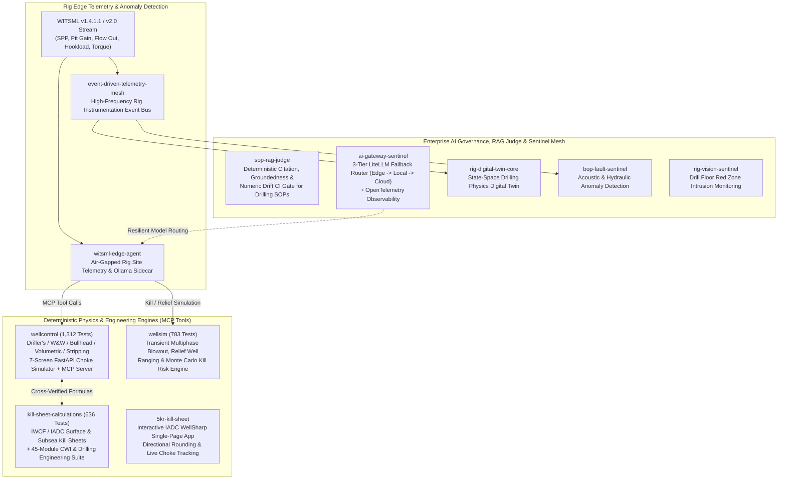

# Kirk Keel — Senior Well Control Specialist & Energy AI Architect

**Senior Well Control Specialist at Boots & Coots · Certified Well Control Instructor · 25+ Years in Operations Management**  
*Well Operations, Drilling, Completions & Well Intervention (Land & Sea) · Surface & Subsea BOPs · Active & Passive MPD*

🌐 **Engineering Hub & Blog:** [**eng.kcklayton.com**](https://eng.kcklayton.com)  
🧪 **Live Production Simulators:** [**kill.kcklayton.com**](https://kill.kcklayton.com) · [**wellsim.kcklayton.com**](https://wellsim.kcklayton.com) · [**wellcontrol.kcklayton.com**](https://wellcontrol.kcklayton.com)

Through years of software engineering alongside field operations, I design and build production-grade AI architectures for safety-critical energy operations—combining **real-time WITSML rig telemetry**, **deterministic multiphase well control physics**, **Model Context Protocol (MCP) tool servers**, and **CI-gated compliance evaluation**.

> **Core Architectural Principle:** *Never let an LLM guess wellbore pressures.* Every agentic workflow in this portfolio pairs LLM reasoning and SOP retrieval with deterministic, API RP 53 / IADC / IWCF-verified physics engines and automated CI evaluation gates.

---

## End-to-End Rig Edge AI & Well Control Architecture

> See [**`docs/ARCHITECTURE.md`**](docs/ARCHITECTURE.md) for the complete sequence diagram and integration specification connecting WITSML telemetry, the `wellcontrol` MCP server, `wellsim` multiphase simulation, and `sop-rag-judge`.

---

## Flagship Public Portfolio (`2,731+` Automated Tests)

### 1. Deterministic Well Control, Blowout Simulation & CWI Engineering

| Repository | Focus Area & Live Apps | Verification & Highlights |
| :--- | :--- | :--- |
| **[5kr-kill-sheet](https://github.com/Greybeard00007/5kr-kill-sheet)** | **Interactive IADC WellSharp Kill Sheet Web App** 🌐 Live at: **[kill.kcklayton.com](https://kill.kcklayton.com)** | **12 passing unit tests** · Zero-dependency single-page calculation engine · Enforces strict directional rounding (KMW round UP, LOT/MAMW round DOWN, MAASP round DOWN) with floating-point epsilon safeguards · SVG kill plot, printable kill sheet with sign-off blocks & live actual-vs-planned choke deviation tracking. |
| **[wellcontrol](https://github.com/Greybeard00007/wellcontrol)** | **Full-Lifecycle Well Control Engine, 7-Screen Choke Simulator & MCP Server** 🌐 Live at: **[wellcontrol.kcklayton.com](https://wellcontrol.kcklayton.com)** | **1,312 passing tests** · Zero external runtime dependencies for core math · Driller's Method, Wait & Weight, Concurrent, Bullheading, Volumetric, Stripping/Snubbing, Barite Requirements, Multi-station Torque & Drag, and real-time FastAPI/WebSocket Choke Simulator + **Model Context Protocol (MCP) Server**. |
| **[wellsim](https://github.com/Greybeard00007/wellsim)** | **Transient Multiphase Blowout, Relief Well Ranging & Dynamic Kill Simulator** 🌐 Live at: **[wellsim.kcklayton.com](https://wellsim.kcklayton.com)** | **783 passing tests** · Drift-flux multiphase hydraulics, Peng-Robinson / Beggs-Brill PVT, OLGA benchmarks, magnetic ranging & intersection solver, Monte Carlo kill risk quantification, and React/Three.js 3D trajectory frontend. |
| **[kill-sheet-calculations](https://github.com/Greybeard00007/kill-sheet-calculations)** | **IWCF / IADC Kill Sheet Engine + 45-Module CWI & Drilling Engineering Suite** | **636 passing tests** · Zero-dependency Python package (`killsheet`) + programmatic 45-sheet Excel engineering generator covering Coiled Tubing, Snubbing, Wireline, Hydraulic Workover, Subsea Kill Sheets, Casing Design, and Tubing Stress Analysis. |

### 2. Agentic WITSML Telemetry, RAG Governance & Sentinel Mesh

| Repository | Focus Area | Verification & Highlights |
| :--- | :--- | :--- |
| **[witsml-edge-agent](https://github.com/Greybeard00007/witsml-edge-agent)** | **Air-Gapped Rig-Edge WITSML AI Sidecar & Live Operator Dashboard** | Designed for intermittent satellite connectivity on remote rigs; runs containerized Node.js + local Ollama inference (`llama3.2:3b`) with deterministic SOP guardrails and WebSocket alerting. |
| **[ai-gateway-sentinel](https://github.com/Greybeard00007/ai-gateway-sentinel)** | **Enterprise Energy AI Reference Architecture & LiteLLM Gateway** | Production starter with 3-tier multi-model fallback routing (`edge-fast` $\rightarrow$ `edge-reasoning` $\rightarrow$ `cloud-fallback`), strict JSON schema validation, and OpenTelemetry distributed tracing. |
| **[bop-fault-sentinel](https://github.com/Greybeard00007/bop-fault-sentinel)** | **BOP Acoustic & Hydraulic Signature Anomaly Detection** | Subsea and surface BOP monitoring engine analyzing hydraulic accumulator signatures and acoustic transients for early fault detection. |
| **[event-driven-telemetry-mesh](https://github.com/Greybeard00007/event-driven-telemetry-mesh)** | **High-Frequency Rig Telemetry Stream & Event Bus** | Low-latency event streaming architecture designed for distributed sensor networks on modern cyber rigs. |
| **[rig-digital-twin-core](https://github.com/Greybeard00007/rig-digital-twin-core)** | **Physics-Informed Digital Twin of Rig Systems** | State-space dynamic modeling of drawworks hoisting, mud pump circulation, and top drive rotation. |
| **[rig-vision-sentinel](https://github.com/Greybeard00007/rig-vision-sentinel)** | **Computer Vision Red Zone Intrusion & Safety Monitoring** | Real-time object detection and spatial boundary enforcement protecting personnel on active drill floors. |
| **[safety-graph-orchestrator](https://github.com/Greybeard00007/safety-graph-orchestrator)** | **Knowledge Graph Barrier Verification & API RP 53 Compliance** | Automated verification of well control barrier envelopes and regulatory standards compliance. |
| **[wellbore-knowledge-graph](https://github.com/Greybeard00007/wellbore-knowledge-graph)** | **Wellbore Ontology & Offset Well Analytics** | Semantic graph database connecting historical well logs, casing programs, lithology, and operational drilling incidents. |

---

## Technical Stack & Domain Expertise

- **Well Operations & Petroleum Engineering:** Surface & Subsea Well Control (IWCF / IADC / API RP 53 / API RP 59), Dynamic Kill & Relief Well Design, Completion & Well Intervention (Coiled Tubing, Snubbing, Hydraulic Workover, Wireline, Slickline), Torque & Drag, Multiphase Hydraulics.
- **AI Architecture & Agentic Workflows:** Model Context Protocol (MCP), Deterministic Physics Tool Use, Hybrid Edge/Cloud LLM Routing (LiteLLM, Ollama, vLLM, OpenAI, Anthropic), RAG Evaluation & Hallucination Guardrails.
- **Software Engineering & MLOps:** Python (`pytest`, `FastAPI`, `Pydantic`, `NumPy`, `SciPy`, `Streamlit`), TypeScript / Node.js, React / Three.js, Docker, GitHub Actions CI/CD, WITSML / Energistics Real-Time Telemetry.
