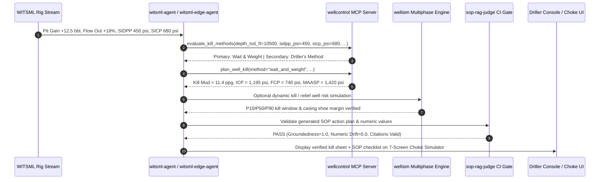

# End-to-End Reference Architecture: Rig Edge Telemetry to Deterministic Well Control

This document details how the 7 engineering and AI repositories in the [`Greybeard00007`](https://github.com/Greybeard00007) portfolio integrate into a single, safety-critical **Energy AI Architecture**.

---

## 1. Architectural Layers

### Layer 1: Edge & Cloud WITSML Telemetry Ingestion
- **[`witsml-edge-agent`](https://github.com/Greybeard00007/witsml-edge-agent):** Deployed as an air-gapped Docker sidecar on the rig floor. Parses real-time WITSML XML/JSON streams (standpipe pressure, pit volume, flow-out, hookload) and runs sub-second deterministic threshold checks before querying a local Ollama model (`llama3.2:3b`).
- **[`witsml-agent`](https://github.com/Greybeard00007/witsml-agent):** Python-based real-time drilling anomaly detector and agentic root-cause triage engine for kick, lost circulation, and pack-off/washout detection.

### Layer 2: Deterministic Physics & Engineering Engines (MCP Tool Layer)
LLMs never estimate bottomhole pressures or kill mud weights via free-text generation. Instead, the agent invokes deterministic tools exposed via the **Model Context Protocol (MCP)**:
- **[`wellcontrol`](https://github.com/Greybeard00007/wellcontrol):** Exposes 5 MCP tools (`evaluate_kill_methods`, `plan_well_kill`, `plan_stripping_and_snubbing`, `simulator_list_scenarios`, `simulator_create_or_step`) backed by 1,312 unit and integration tests.
- **[`wellsim`](https://github.com/Greybeard00007/wellsim):** Provides transient multiphase drift-flux blowout simulation, relief well magnetic ranging, dynamic kill hydraulics, and Monte Carlo kill risk quantification (783 tests).
- **[`kill-sheet-calculations`](https://github.com/Greybeard00007/kill-sheet-calculations):** Provides zero-dependency IWCF/IADC surface and subsea kill sheet calculations alongside a 45-sheet Drilling, Completion & Well Intervention (CWI) Excel engineering suite (636 tests).

### Layer 3: Deterministic RAG Governance & Multi-Model Routing
- **[`sop-rag-judge`](https://github.com/Greybeard00007/sop-rag-judge):** Evaluates every generated SOP recommendation for groundedness, citation integrity, prompt-injection resilience, and zero numeric drift against API RP 53 / IADC standards before any output reaches the driller's console.
- **[`ai-project-template`](https://github.com/Greybeard00007/ai-project-template):** Provides the LiteLLM 3-tier fallback gateway (`edge-fast` $\rightarrow$ `edge-reasoning` $\rightarrow$ `cloud-fallback`) and OpenTelemetry tracing infrastructure.

---

## 2. End-to-End Sequence Diagram (Kick Detection to Verified Kill Plan)

